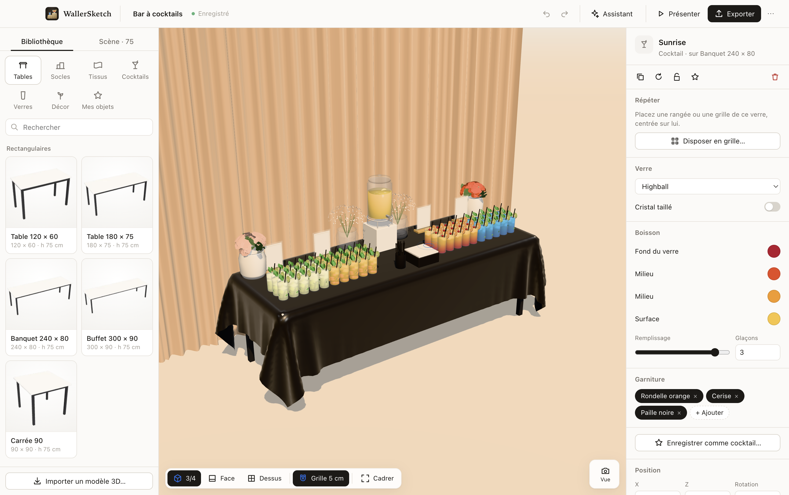
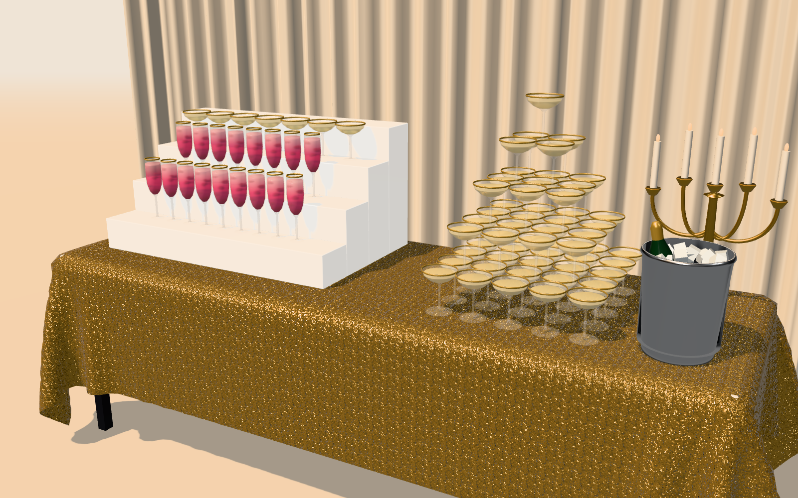

# WallerSketch

[](https://github.com/maclandrol/wallersketch/actions/workflows/ci.yml)
[](https://github.com/maclandrol/wallersketch/releases/latest)
[](https://github.com/maclandrol/wallersketch/releases)


A desktop app to plan cocktail tables in 3D. A barman friend asked me for it, to show clients the setup before an event and to know what to bring on the day.



## Features

- Tables, risers and stepped displays, fabrics, 13 glass types, 23 cocktails, flowers and decor
- Fabrics are simulated and drape over the table and risers
- Objects sit on whatever is under them and move with it
- Grids of glasses, alignment guides and snapping to a 1, 5 or 10 cm grid
- Box selection, with align, distribute, arrange in rows and replace on many objects at once
- Keyboard camera controls, copy and paste, and a shortcuts sheet (press ?)
- Drink builder for your own cocktails
- AI assistant (ChatGPT, DeepSeek or Claude) that creates assets from a description or a photo
- Saved views, presentation mode, PNG export up to 4K
- Dimensioned SVG plan with riser positions and a packing list
- Import GLB, OBJ, STL, PLY, 3MF, DAE, FBX, STEP and IGES; export GLB, OBJ and USDZ
- Works offline; a project is a single `.wsketch` file

The interface is in French.



## Install

Get the latest version from the [releases page](https://github.com/maclandrol/wallersketch/releases/latest).

| System | File | Note |
|---|---|---|
| macOS | `.dmg` | The app is not notarized. The first time, right-click it and choose Open. |
| Windows | `.exe` | If SmartScreen warns, choose More info, then Run anyway. |
| Linux | `.AppImage` or `.deb` | Make the AppImage executable before running it. |
| iPad and tablets | [maclandrol.github.io/wallersketch](https://maclandrol.github.io/wallersketch/) | Open it in Safari, tap Share, then Add to Home Screen. |

The tablet version runs in the browser and works offline once added to the home screen. It has everything except STEP/IGES import and local MCP agents. Projects open from and save to the Files app, and exports go through the share sheet.

The [user guide](docs/GUIDE.md) (French) covers the whole workflow.

## AI assistants

Describe what you want and ChatGPT, DeepSeek or Claude prepares the assets. The simplest way works with the free web or phone apps: the app copies the request, you paste it into the chat, then paste the answer back. With an API key the app asks the model directly, and Claude Desktop, Claude Code or Codex can drive it through the bundled MCP server. Setup is in [docs/AI.md](docs/AI.md), the asset format in [docs/RECIPES.md](docs/RECIPES.md).

## Development

Requires Node.js 22.

```bash
npm ci
```

```bash
npm start
```

| Command | Description |
|---|---|
| `npm test` | Unit tests |
| `npm run e2e` | End-to-end tests in the real app |
| `npm run e2e:web` | Tablet build in WebKit with iPad emulation |
| `npm run serve:web` | Build and serve the tablet version locally |
| `npm run bench` | Performance measurements |
| `npm run typecheck` | TypeScript check |
| `npm run pack:mac`, `pack:win`, `pack:linux` | Build packages into `release/` |
| `npm run docs` | Regenerate `docs/RECIPES.md` |
| `npm run icon` | Redraw the app icon |

CI runs the tests on macOS, Windows and Linux, and the tablet build in WebKit. Tagged versions are built and tested on each system before they are published, and the tablet version is deployed to GitHub Pages from main. See [docs/ARCHITECTURE.md](docs/ARCHITECTURE.md) for how the app works and [THIRD_PARTY_NOTICES.md](THIRD_PARTY_NOTICES.md) for licences.
